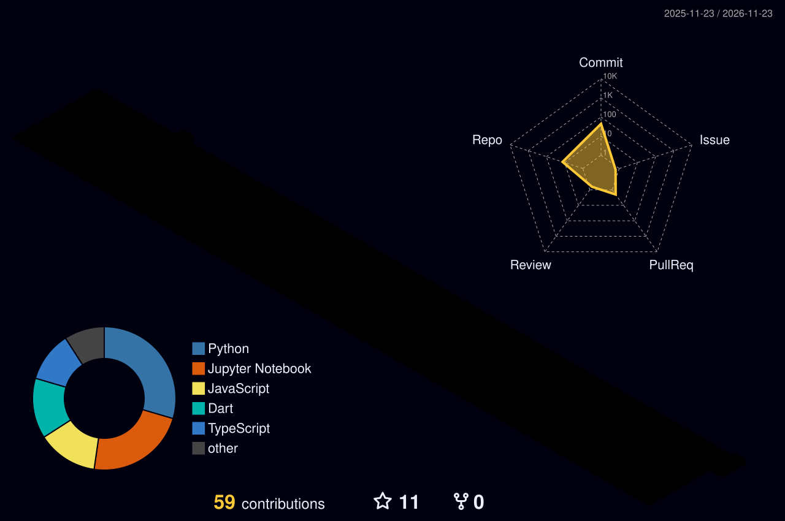

<!-- ===================== HEADER ===================== -->
<p align="center">
  
</p>

<p align="center">
  <a href="https://github.com/robilprogramer">
    
  </a>
</p>

<p align="center">
  <a href="https://robil.chatbotdev.online"></a>
  <a href="mailto:robilputra19@gmail.com"></a>
  <a href="https://github.com/robilprogramer?tab=followers"></a>
  
</p>


## 👨‍💻 Tentang Saya


Saya adalah **Full-Stack Developer** berbasis di **Jakarta, Indonesia 🇮🇩** dengan pengalaman **6+ tahun** membangun aplikasi web, mobile, dan sistem enterprise yang **efisien, skalabel, dan ramah pengguna** — dari UI yang halus sampai backend microservices, pipeline data, dan integrasi AI.

- 🔭 Sedang membangun **AI-powered chat widget & SDK** ([ws-chat-sdk](https://github.com/robilprogramer/ws-chat-sdk))
- 🤖 Mengembangkan solusi **NLP & Machine Learning** — klasifikasi teks, IndoBERT, MLOps
- 🏦 Berpengalaman di **Financial Systems** dengan ASP.NET, VB.NET & SQL Server
- 🌱 Sedang mendalami **AI Agents, MCP, RAG, Rust** & **Edge Computing**
- 💬 Tanya saya tentang **React/Next.js, Spring Boot, Go, Microservices, Flutter**
- ⚡ Fun fact: *"Code is like humor. When you have to explain it, it's bad."*

<br clear="right"/>

```ts
const robil = {
  role: "Full-Stack Developer & AI Engineer",
  location: "Jakarta, Indonesia 🇮🇩",
  experience: "6+ years",
  code: {
    frontend: ["React 19", "Next.js 15", "Vue / Nuxt", "Angular", "Tailwind CSS"],
    backend: ["Spring Boot", "Go", "NestJS", "ASP.NET Core", "FastAPI", "Laravel"],
    mobile: ["Flutter", "React Native", "Kotlin"],
    ai: ["LLM / RAG", "LangChain", "AI Agents & MCP", "IndoBERT", "scikit-learn"],
    data: ["PostgreSQL", "SQL Server", "MongoDB", "Redis", "Kafka"],
    cloud: ["Docker", "Kubernetes", "AWS", "GCP", "GitHub Actions", "Terraform"],
  },
  architecture: ["Microservices", "Event-Driven", "Clean Architecture", "Serverless"],
  currentlyLearning: ["Agentic AI", "Rust", "Edge Runtime", "Platform Engineering"],
  motto: "Keep learning, keep building 🚀",
};
```


## 🛠️ Tech Stack

<h3 align="center">💻 Languages</h3>
<p align="center">
  
</p>

<h3 align="center">🎨 Frontend</h3>
<p align="center">
  
</p>

<h3 align="center">⚙️ Backend</h3>
<p align="center">
  
</p>

<h3 align="center">📱 Mobile</h3>
<p align="center">
  
</p>

<h3 align="center">🗄️ Database & Messaging</h3>
<p align="center">
  
  <br/>
  
  
  
</p>

<h3 align="center">☁️ Cloud & DevOps</h3>
<p align="center">
  
</p>

<h3 align="center">🤖 AI / Machine Learning</h3>
<p align="center">
  
  <br/>
  
  
  
  
  
  
  
</p>

<h3 align="center">🧰 Tools</h3>
<p align="center">
  
</p>


## 🚀 Featured Projects

<table>
  <tr>
    <td width="50%" valign="top">
      <h3>💬 <a href="https://github.com/robilprogramer/ws-chat-sdk">ws-chat-sdk</a></h3>
      <p>AI-Powered Customer Service Chat Widget — SDK yang bisa di-embed ke website mana pun dengan realtime WebSocket.</p>
      
      
      
    </td>
    <td width="50%" valign="top">
      <h3>🛡️ <a href="https://github.com/robilprogramer/anti-judol-moderation">anti-judol-moderation</a></h3>
      <p>Deteksi komentar promosi judi online di YouTube: pipeline NLP (TF-IDF, SVM/LR/NB, IndoBERT) + Knowledge-Based System yang explainable.</p>
      
      
      
    </td>
  </tr>
  <tr>
    <td width="50%" valign="top">
      <h3>🗺️ <a href="https://github.com/robilprogramer/courier_map_tracker">courier_map_tracker</a></h3>
      <p>Package Flutter untuk menampilkan pelacakan rute kurir dengan navigasi peta yang dinamis.</p>
      
      
      
    </td>
    <td width="50%" valign="top">
      <h3>⏱️ <a href="https://github.com/robilprogramer/service-absensi-go">service-absensi-go</a></h3>
      <p>REST API sistem absensi yang cepat dan ringan, dibangun dengan Go.</p>
      
      
    </td>
  </tr>
  <tr>
    <td width="50%" valign="top">
      <h3>🧪 <a href="https://github.com/robilprogramer/Workflow-CI">Workflow-CI</a> · <a href="https://github.com/robilprogramer/robil-mlops-diabetes">MLOps Diabetes</a></h3>
      <p>Pipeline MLOps end-to-end: eksperimen, tracking model, dan CI/CD untuk machine learning.</p>
      
      
      
    </td>
    <td width="50%" valign="top">
      <h3>🤖 <a href="https://github.com/robilprogramer/sistem-chatbot-fe">sistem-chatbot-fe</a></h3>
      <p>Frontend sistem chatbot modern dengan TypeScript, terintegrasi dengan layanan AI.</p>
      
      
    </td>
  </tr>
</table>

<p align="center">
  <a href="https://github.com/robilprogramer?tab=repositories"></a>
</p>


## 📊 GitHub Activity

<p align="center">
  
  
</p>

<p align="center">
  
</p>

<h3 align="center">🧊 3D Contribution</h3>
<p align="center">
  <picture>
    <source media="(prefers-color-scheme: dark)" srcset="./profile-3d-contrib/profile-night-rainbow.svg" />
    <source media="(prefers-color-scheme: light)" srcset="./profile-3d-contrib/profile-season-animate.svg" />
    
  </picture>
</p>

<h3 align="center">🐍 Contribution Snake</h3>
<p align="center">
  <picture>
    <source media="(prefers-color-scheme: dark)" srcset="https://raw.githubusercontent.com/robilprogramer/robilprogramer/output/github-snake-dark.svg" />
    <source media="(prefers-color-scheme: light)" srcset="https://raw.githubusercontent.com/robilprogramer/robilprogramer/output/github-snake.svg" />
    
  </picture>
</p>


## 🤝 Let's Connect

<p align="center">
  Senang berdiskusi soal <b>teknologi</b>, <b>open source</b>, dan <b>berbagi ilmu</b> — terutama seputar Web, Mobile, dan AI. 🚀
</p>

<p align="center">
  <a href="https://robil.chatbotdev.online"></a>
  <a href="mailto:robilputra19@gmail.com"></a>
  <a href="https://github.com/robilprogramer"></a>
</p>

<p align="center">
  
</p>
